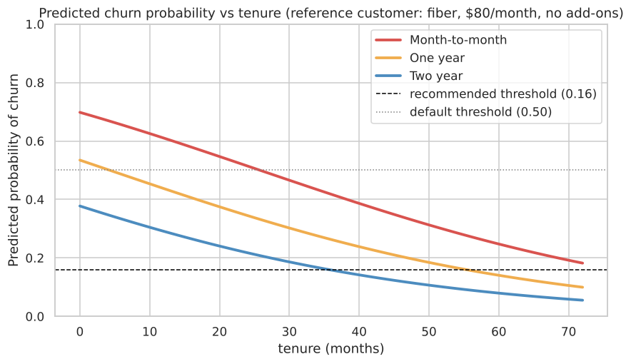

# Telecom Churn Predictor

  

Predict which telecom customers are about to cancel, and decide **who a retention team should actually contact**.

Most churn demos stop at "79% accuracy". This project goes further: it shows why that number is misleading when only about one customer in four churns, and picks the decision threshold by weighing the cost of a missed churner against the cost of a wasted retention offer.


*Predicted churn risk falls with tenure for every contract type; month-to-month customers stay riskiest at every tenure.*

## Highlights
- **Realistic business setup:** 7,043 customers, 26.5% churn, a mix of numeric and categorical features.
- **Leak-free pipeline:** scaling and one-hot encoding live inside a scikit-learn `Pipeline`, so they are learned from training data only, including inside cross-validation.
- **Fairness-aware features:** gender and the senior-citizen flag are excluded; cross-validated AUC is unchanged without them.
- **Beyond accuracy:** confusion matrix, precision, recall, specificity, F1, ROC and precision–recall curves, calibration and lift, all compared with an "always predict Stayed" baseline.
- **Cost-based threshold:** chosen on cross-validated training predictions, never on the test set, with a sensitivity check across cost ratios.
- **Explainable:** coefficients are shown as odds ratios with plain-language readings.

## Results
Evaluated on 1,409 customers the model never saw.

| Metric (threshold 0.5) | Model | Always "Stayed" |
|---|---|---|
| Accuracy | 0.794 | 0.735 |
| Precision | 0.631 | 0 |
| Recall | 0.540 | 0 |
| Specificity | 0.886 | 1.000 |
| F1 | 0.582 | 0 |
| ROC-AUC | 0.838 | 0.500 |

Confusion matrix at 0.5: **917** loyal customers correctly left alone, **118** wrongly flagged, **172** churners missed, **202** churners caught.

### The threshold matters more than the model
| Threshold | Customers flagged | Precision | Recall | F1 |
|---|---|---|---|---|
| 0.3 | 532 | 0.521 | 0.741 | 0.611 |
| 0.5 | 320 | 0.631 | 0.540 | 0.582 |
| 0.7 | 96 | 0.729 | 0.187 | 0.298 |
| **0.16 (cost-optimal)** | 762 | 0.445 | 0.906 | 0.597 |

Assuming a missed churner costs five times a wasted offer, the cost-optimal threshold of about 0.16 is roughly **42% cheaper than contacting everyone** and **39% cheaper than the default 0.5**. A threshold of 0.7 is worse than contacting everybody. That 5:1 ratio is an illustrative assumption; replace it with real offer cost and customer value before trusting the number.

If the team can only contact a fixed share of customers, ranking by risk works without any threshold: the top 20% riskiest customers contain about half of all churners (49.5%), and the top 30% contain about two thirds (65.2%).

### What drives churn
| Raises risk | Lowers risk |
|---|---|
| Fiber-optic internet (odds ×3.0 vs DSL) | Two-year contract (odds ×0.26 vs month-to-month) |
| Electronic-check payment (×1.5) | One-year contract (×0.50) |
| Paperless billing (×1.5) | No internet service (×0.37) |
| Multiple lines, streaming TV and movies (×1.4 each) | Online security (×0.70), tech support (×0.73) |
| | Longer tenure (+1 SD, about 25 months: ×0.45) |

These are associations, not proven causes, and the `MonthlyCharges` coefficient should not be read on its own because price is largely determined by the services already in the model.

## How it works
1. **Frame** the problem: churn is the positive class; a missed churner is costlier than a wasted offer.
2. **Clean:** 11 blank `TotalCharges` values (all brand-new customers) set to 0; redundant "No internet / phone service" labels merged.
3. **Select features:** drop the ID, gender, senior-citizen flag and `TotalCharges` (almost tenure × monthly charge).
4. **Split** 80/20 with stratification; baseline = always predict the majority class.
5. **Train** regularised logistic regression inside a preprocessing pipeline.
6. **Evaluate** with threshold-free (ROC, PR, calibration) and threshold-based metrics.
7. **Choose the threshold** by expected cost on out-of-fold training predictions; report on the test set.
8. **Score new customers** with the saved pipeline.

## Data
| | |
|---|---|
| Dataset | Telco Customer Churn, IBM sample dataset |
| Source | [IBM/telco-customer-churn-on-icp4d](https://github.com/IBM/telco-customer-churn-on-icp4d), saved as `data/Telco-Customer-Churn.csv` |
| Row | One customer account (anonymous ID, no names or contact details) |
| Target | `Churn` (1 = left, 0 = stayed) |

This is a published sample dataset, so results illustrate the method rather than describe a real company.

## Quick start
```bash
git clone <this-repo-url>
cd <this-repo>
pip install -r requirements.txt
jupyter notebook Activity2_Logistic_Regression_Telco_Customer_Churn.ipynb
```

Score a customer with the saved model:
```python
import joblib, pandas as pd
bundle = joblib.load("models/churn_logreg_pipeline.joblib")
customer = pd.DataFrame([{
    "tenure": 4, "MonthlyCharges": 85.0, "Contract": "Month-to-month",
    "InternetService": "Fiber optic", "PaymentMethod": "Electronic check",
    "PaperlessBilling": "Yes", "Partner": "No", "Dependents": "No",
    "PhoneService": "Yes", "MultipleLines": "No", "OnlineSecurity": "No",
    "OnlineBackup": "No", "DeviceProtection": "No", "TechSupport": "No",
    "StreamingTV": "Yes", "StreamingMovies": "Yes"}])
p = bundle["pipeline"].predict_proba(customer[bundle["features"]])[0, 1]
print(f"Churn probability {p:.2f} -> contact: {p >= bundle['recommended_threshold']}")
```
Tested with Python 3.12, scikit-learn 1.9, pandas 3.0. Fixed random seed 42.

## Project structure
```
.
├── Activity2_Logistic_Regression_Telco_Customer_Churn.ipynb   # full analysis, executed
├── data/Telco-Customer-Churn.csv
├── images/                                                    # saved figures
├── results/                                                   # metric, threshold and cost tables
├── models/churn_logreg_pipeline.joblib                        # scaler + encoder + model
└── requirements.txt
```

## Limitations and responsible use
This should rank customers for a human-run retention programme. It must not be used to deny service or set prices for an individual. A probability is an estimate, not a promise. The data is a single snapshot, and included features such as payment method may still act as indirect proxies for protected traits, so error rates should be audited across customer groups before real use.

## Roadmap
- [ ] Class-weighted logistic regression, tuned regularisation, interaction terms
- [ ] Compare with KNN, SVM, random forest and gradient boosting
- [ ] Replace the assumed cost ratio with real offer cost and lifetime value
- [ ] SHAP explanations and per-customer reason codes
- [ ] Fairness audit across customer groups
- [ ] Streamlit or FastAPI scoring app

## Author
Built by [@complexiota](https://github.com/complexiota).
